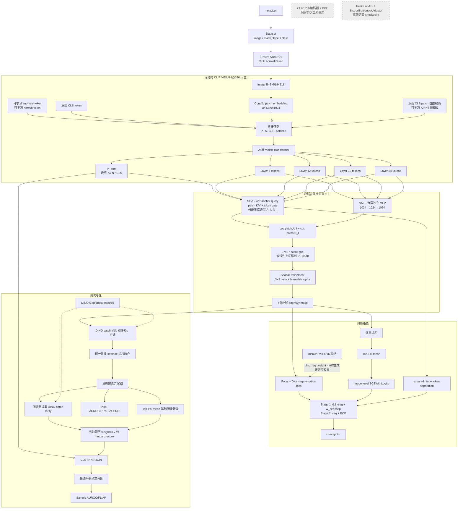

# VisualAD-DINOv3 代码与模型框架审阅

## 1. 当前代码实际实现的模型

该项目实现的是一个以 OpenAI CLIP ViT 为视觉主干的异常检测模型。视觉序列在原有 CLS token 和 patch tokens 前加入可学习的 anomaly token 与 normal token；模型从第 6、12、18、24 个 Transformer block 提取多尺度 token 序列，再通过逐层 SCA 与 SAF 生成异常图。

默认配置（`ViT-L/14@336px`，训练输入 `518×518`）下：

- CLIP 视觉宽度为 1024，24 个 Transformer block，16 个注意力头。
- 输入被切分为 `37×37=1369` 个 patch。
- Transformer 序列为 `[anomaly, normal, CLS, 1369 patches]`，长度 1372。
- anomaly/normal/CLS 和中间层 patch 特征均保持 1024 维；冻结的 `visual.proj` 未用于当前异常检测前向路径。
- 文本 Transformer 与 BPE tokenizer 仅为 CLIP 权重兼容保留，当前训练和测试入口均不使用文本特征。

## 2. 总体框架图

## 3. 两阶段训练的真实参数状态

| 组件 | Stage 1 | Stage 2 | 备注 |
|---|---|---|---|
| anomaly/normal token | 训练 | 冻结 | Stage 1 token LR 默认 5e-4 |
| CLIP Transformer | 冻结 | 冻结 | 预训练主干不更新 |
| `ln_post` | 训练 | 训练 | 默认 LR 1e-3 |
| 每层 SAF MLP | 训练 | 训练 | 没有阶段冻结逻辑 |
| SpatialRefinement | 训练 | 训练 | 没有阶段冻结逻辑 |
| SCA | 冻结 | `requires_grad=True` | 但优化器 LR 始终为 0，实际不更新 |
| DINOv3 | 冻结 | 冻结 | 仅提供可选权重/后处理特征 |

## 4. 文件级审阅结果

### 入口和数据

- `train_twostagetrain.py`：两阶段训练、损失组合、AMP、checkpoint 保存。
- `test.py`：逐图推理、DINO 图传播、多层融合、MuSc patch rarity、RsCIN、指标和可视化。
- `dataset.py`：解析数据集 `meta.json`，读取图像、掩码、类别和样本标签。

### CLIP/VisualAD 核心

- `VisualAD_lib/VisualAD.py`：LayerNorm、Transformer block、ViT、双 token 和文本编码器。
- `VisualAD_lib/build_model.py`：从 CLIP state dict 推断结构，将原位置编码映射到冻结与新增位置编码。
- `VisualAD_lib/model_load.py`：模型下载、校验、JIT/state-dict 加载、预处理和旧相似度辅助函数。
- `VisualAD_lib/transform.py`、`constants.py`：CLIP 图像变换和均值/标准差。
- `VisualAD_lib/simple_tokenizer.py`、`bpe_simple_vocab_16e6.txt`：CLIP BPE；当前训练/测试不走该分支。
- `VisualAD_lib/__init__.py`：导出模型加载接口。

### 可训练检测头和损失

- `utils/spatial_cross_attention.py`：逐层 SpatialBottleneckAttention/SCA。
- `utils/feature_transform.py`：当前 SAF MLP，以及旧 checkpoint 的残差/共享 bottleneck 兼容实现。
- `utils/spatial_refinement.py`：10 参数的异常图空间细化层。
- `utils/training_utils.py`：参数冻结、优化器、SAF 创建、损失聚合及 checkpoint。
- `utils/loss.py`：Focal、Binary Dice 和未被入口使用的 ContrastiveLoss。
- `utils/anomaly_detection.py`：异常图生成工具；训练脚本另有一份更稳健的重复实现。
- `utils/scoring.py`：Top-K mean、softmax、mean 三类异常图降维评分。

### DINOv3 与测试后处理

- `utils/dino_teacher.py`：冻结的 timm DINOv3 ViT-L/16 多层特征提取器。
- `utils/mutual_scoring_faithful.py`：跨同类测试图像的 patch rarity 分数。
- `utils/mutual_scoring.py`：Top-K 与 mutual 分数的 z-score 融合。
- `utils/rscin.py`：使用 CLIP CLS token 构建图像 kNN 并传播图像分数。
- `utils/normalization.py`：逐图 min-max 异常图归一化。

### 评估和展示

- `utils/metrics.py`：像素和图像 AUROC/F1/AP、像素 AUPRO。
- `utils/analysis.py`：按类别统计图像分数分布与偏向。
- `utils/visualization.py`：保存原图、GT、热图叠加及分布图表。
- `utils/transforms.py`：训练/测试入口共用的图像与 mask 预处理。
- `utils/logger.py`：文件和控制台日志。
- `utils/__init__.py`：工具模块统一导出。
- `utils/optim/__init__.py`：占位模块，无实际优化器实现。

## 5. 影响当前框架行为的代码问题

1. `Dataset` 默认 `mode='test'`，训练入口未显式传入 `mode='train'`，因此训练脚本实际读取 `meta.json['test']`。
2. SCA 优化器组由 `stage1_cross_attn_lr=0` 创建；阶段切换只修改 token LR，从未应用 `stage2_cross_attn_lr`，所以 SCA 即使在 Stage 2 开启梯度也不会更新。
3. 恢复训练时未把 `spatial_refiner` 传给 `load_checkpoint`，而 `load_checkpoint` 也没有接收/恢复 SCA；这两部分会以随机/初始参数继续训练。
4. `dino_reg_weight` 只控制是否进入 DINO 加权分支，没有作为数值系数乘入损失；默认 0 时训练仍无条件实例化完整 DINOv3。
5. `clip_feat_maps` 被构造并标注用于 `L_struct`，但之后没有参与任何结构蒸馏损失；当前代码并未实现注释声称的关系蒸馏。
6. 测试在 DINO 完整可用时调用 `fuse_scores(..., weight=0.0)`，最终图像基础分数完全来自 mutual rarity 的 z-score，Top-K 分数被赋予零权重。
7. tokenizer 查找 `bpe_simple_vocab_16e6.txt.gz`，仓库中资源实际名为 `bpe_simple_vocab_16e6.txt`，但内容确实是 gzip 数据；文本分支启用时会找不到文件。
8. `model_load.load_checkpoint` 引用了未定义的 `convert_to_custom_text_state_dict` 和 `resize_pos_embed`，调用该兼容加载函数会失败。
9. DINO 接收的是已经按 CLIP 均值/方差归一化的张量，没有执行 DINO/timm 模型自己的 data config 预处理。
10. `mutual_scoring_faithful` 在未传 device 时固定优先使用 `cuda:0`，忽略测试参数中的其他 CUDA 设备；声明的 `chunk_size` 也未实现。
11. `cal_pro_score` 在所有异常图值完全相同时会得到零步长；AUROC 只检查数组非空，没有检查标签是否同时包含正负两类。
12. 可视化原图通过当前 tensor 的 min-max 恢复，未执行 CLIP 反归一化，因此展示颜色可能失真。

## 6. 静态验证

- 共审阅 29 个 Python 文件和 1 个 BPE 资源文件。
- 所有 Python 文件均通过 `ast.parse` 语法检查。
- BPE 文件 gzip magic 为 `1f8b`，解压后包含 262,145 行；资源内容有效，但扩展名与 tokenizer 期望不一致。
- 当前环境没有安装 PyTorch，因此未执行模型实例化、前向传播或训练测试。
